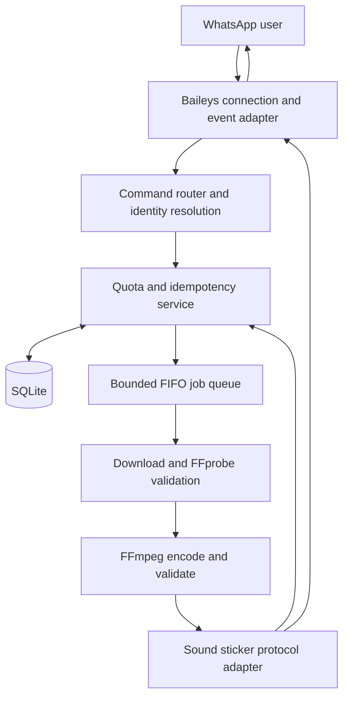

# Product Requirements Document — WhatsApp Sound Sticker Bot

- **Version:** 1.0 (MVP)
- **Status:** Ready for implementation, subject to protocol proof of concept
- **Deployment:** Self-hosted Linux VPS
- **Target:** Personal / small-community WhatsApp bot
- **Date:** 2026-11-26

## 1. Product overview

Build a lightweight WhatsApp bot that converts videos containing audio into native animated WhatsApp stickers with playable sound. Users send a video to the bot and receive a sound sticker in the same chat. The operator controls per-user and global usage limits, including an allowlist of phone numbers that have unlimited usage.

The bot must be self-hostable on a single VPS, require minimal maintenance, and survive restarts without losing its WhatsApp session or quota history.

### 1.1 Goals

- Generate native sound stickers, not a video, GIF, or separate voice note.
- Provide a simple WhatsApp-only user experience.
- Enforce configurable quotas consistently under concurrent requests.
- Deploy with Docker Compose and persistent storage.
- Prioritize working protocol compatibility and fast development over architectural complexity.

### 1.2 Non-goals

No frontend, public HTTP API, admin dashboard, payment, subscription, multi-account support, distributed workers, Redis, PostgreSQL, object storage, media URL downloader, static stickers, silent stickers, sticker editing, or group support in MVP. Group support can be added later. No unsolicited outbound messages or bulk messaging.

## 2. Technical decisions

| Layer | Choice | Rationale |
| --- | --- | --- |
| Runtime | Node.js 24 LTS | Compatible with the reference implementation and convenient for rapid iteration |
| Language | TypeScript, strict mode | Typed contracts and maintainability |
| WhatsApp | Baileys, exact tested version | Linked-device integration; existing sound-sticker example |
| Media | FFmpeg and FFprobe CLI | Animated WebP, Opus, media inspection |
| Storage | SQLite with `better-sqlite3` | Persistent quotas and request deduplication, no external service |
| Configuration | YAML parsed with `yaml`, validated with Zod | Human-editable configuration with fail-fast validation |
| Logging | Pino | Structured logs and redaction |
| Scheduling | Bounded in-process queue | Small, single-instance workload |
| Testing | Vitest | Unit and integration tests |
| Deployment | Docker Compose, Debian-based Node image | Predictable native dependencies and persistent volumes |

Architecture: single-process modular monolith, one replica only. Use npm and commit the lockfile. Avoid adding a web framework or ORM. Use direct parameterized SQLite queries and versioned migrations. Pin dependency and container versions after the protocol spike succeeds.

**Alternative:** Go + Whatsmeow may be considered if Baileys proves unsuitable, but do not build two implementations during MVP. The choice of TypeScript is based on the availability of a more directly relevant reference implementation, not a guarantee of present-day compatibility.

## 3. User experience

### 3.1 Commands

| Command | Behavior |
| --- | --- |
| `.s` | Convert a video with audio into a native sound sticker. Accept as a video caption or a text reply to a video. |
| `.limit` | Show current personal and global quota status and next reset time; show unlimited status when applicable. |
| `.help` | Show short usage instructions and input constraints. |

Commands are case-insensitive, use exact trimmed matches, and do not consume quota themselves except a successful `.s` conversion. Other messages, history-sync messages, group messages, bot-originated messages and status broadcasts are ignored. The bot accepts direct chats only. Do not fetch arbitrary external URLs or process view-once media.

### 3.2 Main flow

1. User sends a video with caption `.s`, or replies to a video with `.s`.
2. Resolve the incoming message identity and sender's verified phone-number identity; deduplicate the request.
3. Reject unsupported input, exceeded quota or full queue with a short actionable message.
4. Atomically reserve applicable quota and enqueue the job; acknowledge that processing has started or is queued.
5. Download the video into a private temporary directory and validate it using FFprobe.
6. Trim and encode the video and audio to synchronized outputs; validate output formats and size.
7. Upload the two media objects and send a single native sound sticker replying to the requesting message.
8. On confirmed send success, finalize quota usage. On definite failure, release the reservation. Clean temporary files in all terminal paths.

Example success: the bot replies with the sticker itself, not an extra video or audio message. Failure example: `Video ini tidak memiliki audio. Kirim video yang ada suaranya, ya.` Default bot response language: Indonesian.

## 4. Functional requirements

### FR-01 — WhatsApp connectivity (P0)

- Pair a dedicated WhatsApp account using a QR code displayed in an interactive terminal. Pairing code is optional and out of scope unless trivially available.
- Persist linked-device credentials and encryption keys under the data directory; use a single-process serialized auth store appropriate to the chosen Baileys version.
- Reconnect on transient failures with bounded exponential backoff and jitter. Do not create overlapping sockets or duplicate handlers.
- If logged out or revoked, stop processing, report the reason and require manual re-pairing; never loop login attempts.
- Restarting the container must not require a new QR scan while the linked-device session remains valid.

### FR-02 — Audio sticker conversion (P0)

- Accept WhatsApp video messages (initially MP4; validate content, not just MIME or extension) containing at least one valid audio and video stream.
- Reject unsupported or corrupt media, videos without an audio stream, and inputs over the configured byte limit. Do not fall back silently to a muted sticker.
- Trim inputs longer than the configured output duration from the start. Preserve aspect ratio with transparent padding, without stretching or cropping by default.
- Produce animated WebP, 512 x 512 pixels, looping; Ogg/Opus mono audio as a separate file. Keep both tracks on the same effective duration and validate timing from actual output metadata (use WebP frame timestamps if FFprobe cannot inspect them).
- Target WebP <= 500,000 bytes by default; this is a conservative configurable MVP target, not a confirmed sound-sticker-specific Meta limit. If necessary, reduce quality and FPS through a finite retry ladder. If still too large, reject with a useful error.
- Validate the generated WebP contains animation frames and the Ogg contains Opus audio. Enforce a configurable audio byte ceiling. Clip duration and track timing must be verified in playback tests.
- Upload WebP and audio separately using their corresponding WhatsApp media type/encryption context; construct the native sticker message with embedded audio metadata using the proven protocol adapter.
- Verify that a supported recipient WhatsApp client displays a native sticker and plays audio on tap. Sending an ordinary animated WebP with no playable audio is not success for the protocol milestone.

### FR-03 — Per-user usage limit (P0)

- Configurable maximum successful sticker conversions per non-exempt sender per calendar day.
- Default: 10 per day; calculate day boundary at midnight in `Asia/Jakarta`.
- Count by canonical sender phone identity across all supported chat contexts, not by chat ID or display name.
- Resolve Baileys phone-number and LID addressing using its authenticated mapping. Never infer an E.164 number from an opaque LID. If a sender cannot be mapped safely, reject the conversion rather than bypass quota or incorrectly grant unlimited access.
- Evaluate completed usage plus pending reservations before accepting a request.
- Failed conversions do not consume successful-use quota; deduplicated events never consume additional quota.

### FR-04 — Global usage limit (P0)

- Configurable shared daily quota across all non-exempt users. Default: 200 successful conversions per day.
- All requests subject to quotas must pass BOTH the personal limit and global limit before enqueueing.
- Global usage is shared across users and is persisted in SQLite.
- If the global quota is exhausted, reject limited users even when they have personal quota left.
- Reset uses the same local day boundary as the per-user quota.

### FR-05 — Unlimited users (P0)

- Operator defines a list of E.164 phone numbers in YAML. Store and compare canonical digits after validated normalization.
- Allowlisted numbers bypass BOTH per-user and global usage quotas. Their conversions do not consume the shared daily budget.
- They still obey input limits, queue capacity, per-sender concurrency, timeouts and safety constraints. `Unlimited` does not mean unlimited server resources.
- Match only trusted sender identity, never a phone number taken from user-provided text or a display name.
- `.limit` must report unlimited usage status for these users. Track their successful usage separately for operator visibility.

### FR-06 — Configuration (P0)

- Read configuration from a mounted YAML file at startup. Validate schema and reject invalid values before connecting.
- Apply changes on application restart; no runtime admin commands or hot reload for MVP.
- Provide `config.example.yaml`; document every field and its units.
- Support `0` as a zero allowance (deny limited users), not as unlimited. Use explicit `null` to disable either daily quota. Unlimited-number rules still apply.
- The operator can edit limits and allowlist without rebuilding the image. Changing quotas does not erase the existing day's usage.

### FR-07 — Queue and resource limits (P0)

- Use a bounded FIFO queue with a configurable number of active conversion workers and maximum waiting jobs.
- Default: 1 active worker, 10 waiting jobs, at most 1 pending or active job per sender including unlimited users.
- Reject new jobs when full with a retry-later message. Do not consume quota on queue rejection.
- Bound media downloads by actual bytes, processing by deadline, and encoder retry attempts. Kill FFmpeg process groups on cancellation/timeout.
- No unbounded parallel FFmpeg processes or unbounded retries.

### FR-08 — Deduplication and failure recovery (P0)

- Persist an idempotency key built from account identity, chat identity and incoming message ID. A replay must not trigger another sticker or reservation.
- Reserve a quota and record the request in one SQLite transaction. Store admission date and exemption status; use these for all later settlement, even across midnight or configuration changes.
- On restart, abort unfinished queued/converting jobs that never attempted a send, release reservations and clean stale temp directories. Users may send a new request. Queue persistence/replay is not required for MVP.
- Persist a `sending` state before the network send. If send acceptance is uncertain (timeout, crash after send), mark `unknown`, do not automatically resend, and conservatively keep the reservation counted for that admission day. Log the ambiguity; reconcile manually if needed. This intentionally prefers preventing duplicates and quota oversubscription over perfect quota refunds.
- A successful send is defined for accounting as the transport reporting acceptance, not guaranteed playback on every recipient device.

### FR-09 — Operations (P0)

- Log connection state, request ID, result, timing, byte sizes, quota rejection reason and queue depth; use redacted or hashed user identifiers in routine logs.
- Provide a local container healthcheck indicating process readiness, database access and connection state. Document that Docker health status alone does not restart an unhealthy container.
- Handle SIGTERM gracefully: stop admitting requests, drain or cancel active jobs within a bounded grace period, persist final states and close connections.
- Keep no permanent copies of incoming videos or generated sticker/audio files. Remove temporary media on success, failure, timeout, and startup cleanup after a crash.

## 5. Configuration example

```yaml
bot:
  command: ".s"
  locale: "id-ID"
  direct_messages_only: true

quota:
  timezone: "Asia/Jakarta"
  per_user_daily: 10
  global_daily: 200
  unlimited_numbers: []
  # Add quoted E.164 phone numbers here, e.g. an operator-owned +62 number.

media:
  max_input_bytes: 20971520   # 20 MiB
  max_duration_seconds: 5
  sticker_max_bytes: 500000
  audio_max_bytes: 262144
  width: 512
  height: 512
  fps: 12
  min_fps: 6
  webp_quality: 60
  min_webp_quality: 30
  audio_bitrate_kbps: 32
  audio_channels: 1
  max_encode_attempts: 6
  processing_timeout_seconds: 90

queue:
  concurrency: 1
  max_waiting: 10
  max_pending_per_user: 1
  max_wait_seconds: 120

storage:
  database_path: "/data/bot.sqlite"
  session_path: "/data/session"
  temp_path: "/tmp/sticker-bot"
  request_retention_days: 30

logging:
  level: "info"
```

All numerical defaults are proposed MVP settings, not verified WhatsApp protocol maxima. Validate ranges, timezone, distinct paths, allowlist formatting and duplicate entries. Enforce the fixed 512 x 512 output contract. Limit configuration to reasonable resource ceilings; ensure minimum values do not exceed corresponding starting values. Keep auth credentials outside YAML and source control. Config reload requires restart.

### Quota examples

| Scenario | Expected result |
| --- | --- |
| User consumed 9/10, global 199/200 | One more accepted reservation |
| Two users simultaneously request the final global slot | Exactly one accepted |
| User exhausted personal quota, global has capacity | Rejected |
| Global exhausted, user has personal capacity | Rejected |
| Unlimited user, both quotas exhausted | Accepted if operational capacity exists |
| Definitive media/encoding/send failure | Reservation refunded |
| Unknown send outcome | Reservation retained for admission day; no auto-resend |
| Request admitted before midnight, finishes after midnight | Charged to admission day |
| Same sender sends a new request during an active job | Rejected by concurrency guard |

## 6. Architecture



### Suggested repository structure

```text
wa-sound-sticker-bot/
├── src/
│   ├── index.ts
│   ├── config/             # Load and validate YAML
│   ├── whatsapp/           # Connection, auth, identity, event parsing
│   ├── commands/           # .s, .limit, .help
│   ├── sticker/            # Probe, encode, validate, protocol adapter
│   ├── quota/              # Admission, reservation, settlement
│   ├── queue/              # Bounded FIFO workers and cancellation
│   ├── storage/            # SQLite repository and migrations
│   └── logger.ts
├── migrations/
├── scripts/                # Protocol spike, maintenance
├── tests/
│   ├── unit/
│   ├── integration/
│   └── fixtures/
├── config.example.yaml
├── Dockerfile
├── compose.yaml
├── package.json
├── package-lock.json
├── tsconfig.json
├── .gitignore
├── .dockerignore
├── README.md
└── PRD.md
```

Keep interfaces small. Isolate WhatsApp-specific protobuf code from conversion and quota logic so it can be patched or swapped without rewriting the bot.

## 7. Sound sticker protocol and implementation spike

**Blocking technical risk:** the native audio sticker wire format is new and unofficial; presence of a protobuf field does not prove the server or recipient will accept and play it. Do not build the entire MVP before testing this.

References report two different protocol constructs: embedded `StickerMessage.audioMessage` (field 26) and a separate `Message.audioStickerMessage` wrapper (field 134) whose contents are not fully established. Start with the embedded mechanism demonstrated by the reference bot. Do not assume a wrapper is required without evidence.

### Phase 0 exit criteria

1. Inspect and pin an exact Baileys version. Read its protobuf schema, upload/encryption helpers, generated encoder and reference bot implementation. Check project licenses before reusing code.
2. Implement `scripts/spike-sound-sticker.ts` or an equivalent standalone test that pairs a dedicated test account and accepts pre-generated WebP and Ogg files.
3. Build a native sticker payload with separate uploaded image and audio metadata. If the chosen Baileys encoder omits the embedded audio field, implement an isolated, version-tested adapter/patch, not a blind global monkey-patch. Verify serialized bytes preserve field 26, and validate actual upload metadata and flags against the known-good reference or captured test message.
4. Send to a second account/device running a WhatsApp version supporting sound stickers. Confirm native sticker appearance, animation and tap-to-play audio. Record exact dependency versions, client versions, method and evidence in `docs/protocol-spike.md`.
5. Test a client without the feature if available; record observed fallback behavior. Do not promise universal compatibility.
6. Confirm the same mechanism works with FFmpeg-generated output. Add serialization regression coverage and a reproducible fixture.
7. If the spike fails, report observed errors and stop treating audio sending as solved. Evaluate a pinned compatible fork or Go/Whatsmeow only after reviewing evidence. Do not silently substitute a normal animated sticker.

### Encoding guidance (starting point, not a fixed production command)

```bash
ffmpeg -nostdin -i input.mp4 -t 5 -an \
  -vf 'fps=12,scale=512:512:force_original_aspect_ratio=decrease,format=rgba,pad=512:512:(ow-iw)/2:(oh-ih)/2:color=0x00000000' \
  -c:v libwebp_anim -quality 60 -loop 0 sticker.webp

ffmpeg -nostdin -i input.mp4 -t 5 -vn \
  -c:a libopus -b:a 32k -ac 1 audio.ogg
```

Use explicit stream mapping and output validation in production. Derive audio length from effective animation duration; handle short or offset audio streams and variable frame rate. Adjust or pad/truncate audio as appropriate to preserve synchronization; do not rely on identical `-t` alone. Spawn FFmpeg using argument arrays (no shell interpolation). Use controlled local paths, disable unnecessary network protocols, set deadlines and verify actual supported encoders during container startup/build checks.

## 8. SQLite persistence and quota algorithm

Use WAL mode, foreign keys, a busy timeout and migrations. Keep all reservation transitions transactional. Single replica only; do not mount SQLite over a network filesystem.

Suggested logical tables:

| Table | Key | Fields |
| --- | --- | --- |
| `requests` | `request_key` | `sender_id`, `day_key`, `exempt`, `state`, `created_at`, `updated_at`, `error_code`, optional `outgoing_message_id` |
| `daily_user_usage` | `(day_key, sender_id)` | `used`, `reserved` |
| `daily_global_usage` | `day_key` | `used`, `reserved` |

Store `sender_id` as canonical verified phone digits (or a stable keyed digest of those digits); use the same representation everywhere. Treat the database and session directory as sensitive. Store a UTC timestamp for audit plus an IANA-timezone-derived `YYYY-MM-DD` day key for accounting. User metrics include exempt conversions; global metrics exclude them. Exempt admission skips quota enforcement, but still creates a request and updates user metrics on success. Track in-flight state via the request table for all users.

States: `reserved`, `processing`, `sending`, `succeeded`, `failed`, `unknown`. Use conditional transitions to prevent double settlement. Active sender guard applies to reserved, processing and sending, not terminal unknown.

Admission (within one immediate transaction; synchronous DB section, no awaited calls inside):

```text
resolve identity and validate command
if queue capacity unavailable: reject
begin transaction
  if request already exists: ignore duplicate
  if sender has too many pending jobs: reject
  compute local day key and exemption
  if not exempt:
    reject if enabled personal quota reached (used + reserved)
    reject if enabled global quota reached (used + reserved)
    increment both reservation counters
  insert request in reserved state
commit
try enqueue; if enqueue fails, settle failure and release reservations
```

Use a synchronous admission/enqueue critical section in the single event loop to prevent queue-capacity races. Always maintain counters for non-exempt users even when one or both quota caps are disabled, so enabling caps later in the same day uses accurate history. Success moves applicable reservations to used atomically; definite failure releases them. Exempt success increments user used only. Unknown outcome retains the applicable reservation for the original day. Handle counters using nonnegative constraints and exactly-once conditional state transitions. Clean old terminal records and quota rows after the retention period, retaining current-day data and never deleting active requests. Changing timezone mid-day is an operator-visible accounting boundary change; document the effect and prefer changing it at a reset boundary.

## 9. Deployment requirements

### VPS starting specification (estimate, not benchmark)

- Linux x86-64, Ubuntu or Debian.
- 2 vCPU, 2 GB RAM, 20 GB disk as a starting point for one FFmpeg worker; load test before increasing concurrency.
- Outbound network access to WhatsApp; SSH access for operator. No public application port, domain, TLS proxy or Nginx required for MVP.

### Docker requirements

- Use a multi-stage Debian-based Node.js 24 image; install FFmpeg/FFprobe with WebP animation and Opus encoders; include build tooling for native SQLite dependency in the build stage only as needed.
- Run as non-root, use an init process, use a writable persistent `/data` mount and private bounded temporary storage. Configure owner permissions for bind mounts. Mount YAML read-only.
- Restart policy `unless-stopped`; configure memory/CPU limits suitable for the VPS, log rotation and a stop grace period. Keep only one bot replica and no privileged container.
- Do not bake WhatsApp session files, credentials, database or private config into the image.

Example intended operator workflow (Codex must implement matching scripts):

```bash
cp config.example.yaml config.yaml
# Edit config.yaml, then build and pair interactively.
docker compose build
docker compose run --rm bot npm run pair
# Complete pairing on phone and wait for pairing command to exit.
docker compose up -d
docker compose logs -f --tail=100 bot
```

Use the same volume for pairing and service startup; never run both against the session concurrently. Document backup/restore of SQLite and session files with service stopped (or SQLite-safe backup for live DB), restrict access, and document re-pairing after session revocation. Exclude transient media from backups.

## 10. Security and reliability

- Baileys and the protocol research are unofficial. Account restriction, logout and future protocol breakage are possible. Use a secondary number and limit use to consensual personal/small-community requests; review WhatsApp terms. Do not attempt to evade platform enforcement.
- Restrict access to VPS and session files. Session keys permit account access; never log, publish or commit them. QR pairing output is sensitive; display it only in a private interactive session.
- Untrusted user media is decrypted and processed by the bot. State this in `.help`; never claim end-to-end privacy from the bot operator. Do not retain media after processing.
- Use current patched FFmpeg builds, strict input size/duration and process deadlines, sanitized temporary filenames, non-root execution and no shell injection. Probe downloaded local content, not attacker-selected remote URLs or paths.
- Reject ambiguous identity mappings rather than granting exemptions based on guesswork. Redact personal data in logs and error replies.
- No automated retry after uncertain send results; reconnect with backoff. Exact-once delivery across a remote send and local DB commit cannot be guaranteed without transport-level idempotency.

## 11. Acceptance criteria and test plan

| ID | Test | Expected |
| --- | --- | --- |
| AC-01 | Send a short MP4 with audible sound and `.s` caption | Native animated sticker; supported client plays sound on tap |
| AC-02 | Reply `.s` to a video in a direct chat | Same native output, in the same chat |
| AC-03 | Send longer input | Correctly trimmed, synchronized output within configured limits |
| AC-04 | No audio, corrupt video, oversized upload | Clear error; no charged usage; temp files removed |
| AC-05 | Personal quota = 2; make 3 valid requests | First two successful, third blocked |
| AC-06 | Global quota = 2; requests from 3 limited senders | At most two successful/reserved slots, third blocked |
| AC-07 | Concurrent requests for final global/personal slot | No oversubscription or negative counters |
| AC-08 | Allowlisted sender with both caps exhausted | Accepted if resource capacity exists; global count unchanged |
| AC-09 | Allowlisted user floods or sends oversized media | Operational limits enforced |
| AC-10 | Duplicate delivery of same message event | At most one job and reservation |
| AC-11 | Simulated definite FFmpeg or send failure | Reservation released once; no files left |
| AC-12 | Crash after entering sending state | Unknown result retained; no automatic duplicate send |
| AC-13 | Restart container with completed usage | Session and quota persist; no new QR if session valid |
| AC-14 | Cross midnight in configured timezone | New requests use new day; in-flight request settles original day |
| AC-15 | Queue full / per-sender pending limit reached | New request rejected without consuming quota |
| AC-16 | Edit quota and allowlist, restart | New policy active; prior counts preserved |
| AC-17 | LID without verified phone mapping | No conversion or allowlist bypass; safe error |
| AC-18 | Invalid config, missing encoder or DB inaccessible | Startup fails with actionable error |
| AC-19 | History, groups, own messages, unrecognized command | Ignored without spending quota |
| AC-20 | `.limit` and `.help` | Correct daily status/reset and usage/privacy notice |
| AC-21 | Timeout, shutdown, abandoned processing request | Bounded execution, safe cleanup and recovery |

Automate unit tests for config validation, command parsing, identity resolution, day boundaries, quota transitions, queue behavior and protocol serialization. Integration tests use real SQLite and FFmpeg with small generated fixtures and mock WhatsApp transport. Include a separate opt-in manual WhatsApp end-to-end test; CI must not require real credentials or claim playback verification from mocks.

## 12. Implementation milestones for Codex

### M0 — Protocol validation (blocking)
- Read references and inspect dependencies; run the native sound sticker spike.
- Record verified transport/schema/version and actual playback result. If a linked account or device is unavailable, leave a runnable test and mark this gate pending; do not fabricate results.

### M1 — Core conversion
- Initialize strict TS project, config schema and test harness.
- Implement media probing, bounded FFmpeg conversion, size adaptation, duration matching and temporary-file cleanup.
- Implement and regression-test the protocol adapter validated in M0.

### M2 — WhatsApp flow and quotas
- Implement session lifecycle, identity resolution, `.s`, `.limit` and `.help`.
- Add migrations, transactional quota reservation/settlement, idempotency and bounded queue.
- Add failure paths, log redaction and restart recovery.

### M3 — VPS readiness
- Add Dockerfile, Compose, interactive pairing command and healthcheck.
- Run automated tests and build image; document VPS deploy, config changes, backups, limitations and manual end-to-end test.

### Definition of done

- All P0 requirements implemented and automated acceptance tests passing.
- Manual native sound playback test passes on a supported real WhatsApp client; test environment and results recorded.
- A clean VPS setup can pair and start with documented Docker commands, and session/usage survive restart.
- Example configuration can change both quotas and exempt numbers with no code changes.
- Repository contains README, migrations, configuration example, tests, lockfile and deployment files; contains no private media or credentials.
- Known compatibility limits and unverified behavior are explicitly documented. No mock-only implementation is considered complete.

## 13. References

These are implementation references, not an official supported Meta sound-sticker API. Reviewed 2026-11-26. Recheck exact current versions during M0.

1. [WhatsApp Sound Sticker Bot — reference implementation](https://github.com/DavidRamirez206/whatsapp-sound-sticker-bot) — Baileys/FFmpeg example and encoder adapter; consult source and license.
2. [WhatsApp sticker protocol reverse engineering](https://docs.baron0.com/WA_STICKERS/) — embedded audio field and separate wrapper evidence.
3. [Baileys upstream](https://github.com/WhiskeySockets/Baileys) — inspect pinned release's API and protobuf schema.
4. [FFmpeg documentation](https://ffmpeg.org/documentation.html) — encoder/filters and FFprobe usage.
5. [Whatsmeow protobuf reference](https://pkg.go.dev/go.mau.fi/whatsmeow/proto/waE2E#StickerMessage) — alternative transport investigation only.
6. [WhatsApp Terms of Service](https://www.whatsapp.com/legal/terms-of-service) — unofficial-client risk.

## 14. Instructions for the coding agent

Use this PRD as the source of truth for MVP scope. First inspect the existing repository, if any, and preserve unrelated files. Start with M0; identify exact dependencies and build a minimal reproducible native-sound-sticker test before assuming the protocol works. Do not invent APIs or version numbers. If live pairing/playback cannot be performed, document the blocker and implement the remaining offline-testable parts with explicit pending status. Keep implementation small, use strict types, test failure paths, and avoid unrelated features or infrastructure. Explain material deviations from this PRD and any tests that cannot be executed. Never commit authentication data, private config, or user media.
